# Elevator Design

**A model elevator designed in SolidWorks for a control project: a cabin running on guide rods, lifted by a rope over a pulley with a counterweight, inside a glass shaft.**

Ahmed Mohamed Elanany

  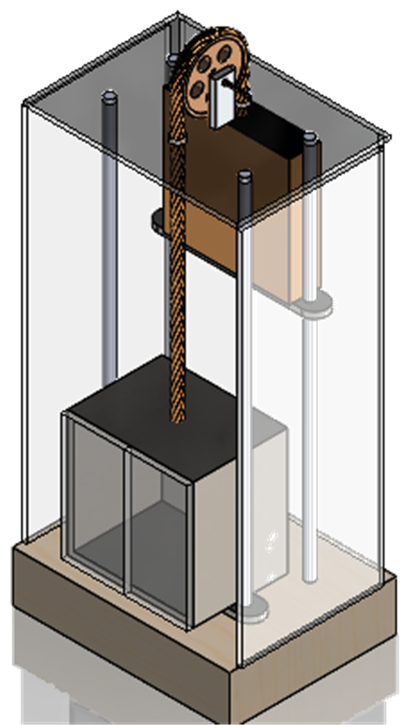

## Demo

▶️ [Watch the elevator working](videos/elevator_demo.mp4)

## Cutting drawings

The 2D drawings of the elevator: front and side views of the shaft, the top views, and every flat part laid out for cutting.

  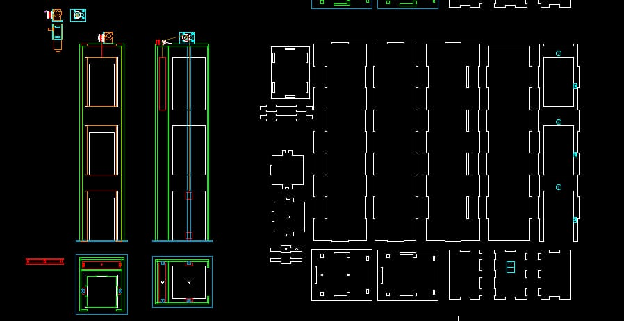

## All parts

  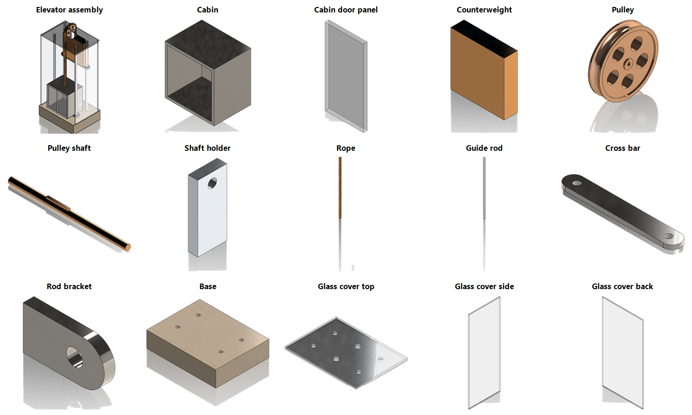

| Part | File | Picture |
| --- | --- | --- |
| Elevator assembly | `elevator assembly.SLDASM` |  |
| Cabin | `Part3.SLDPRT` | 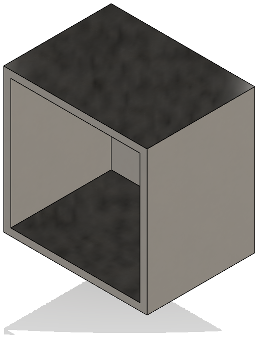 |
| Cabin door panel | `Part6.SLDPRT` | 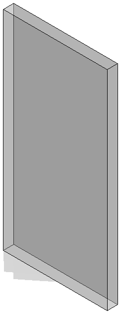 |
| Counterweight | `Part7.SLDPRT` | 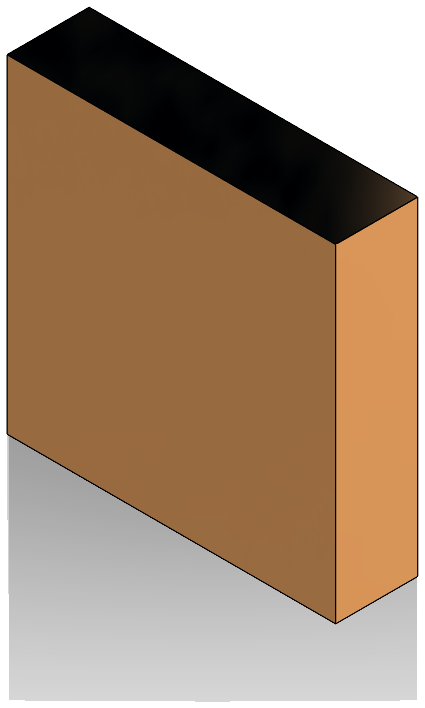 |
| Pulley | `pully.SLDPRT` | 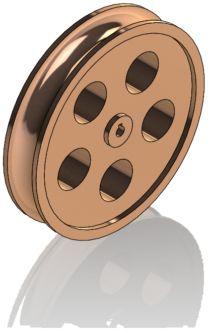 |
| Pulley shaft | `Part12.SLDPRT` | 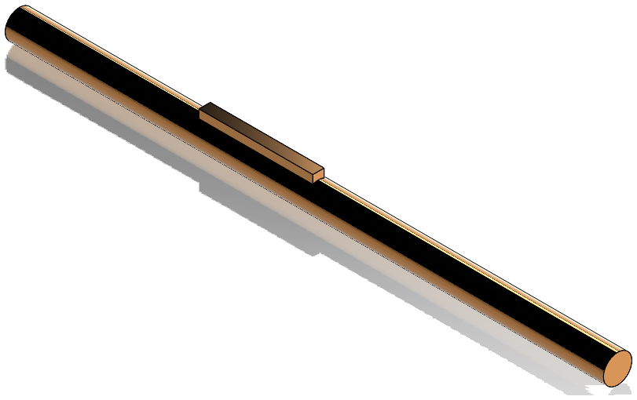 |
| Shaft holder | `Shaft holder.SLDPRT` | 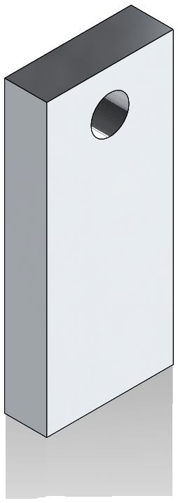 |
| Rope | `Part14.SLDPRT` | 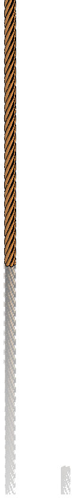 |
| Guide rod | `Part2.SLDPRT` |  |
| Cross bar | `Part4.SLDPRT` | 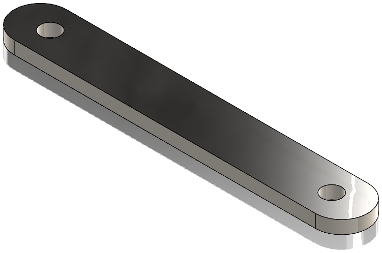 |
| Rod bracket | `Part5.SLDPRT` | 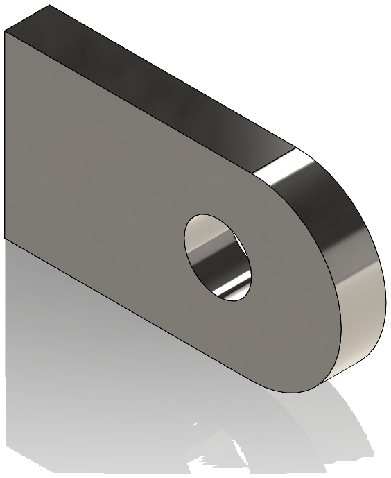 |
| Base | `Part1.SLDPRT` | 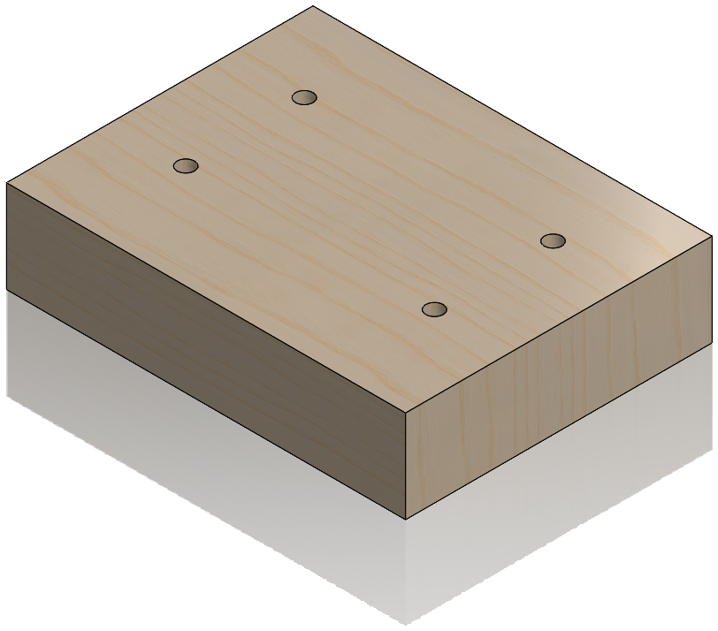 |
| Glass cover top | `Glass cover top.SLDPRT` | 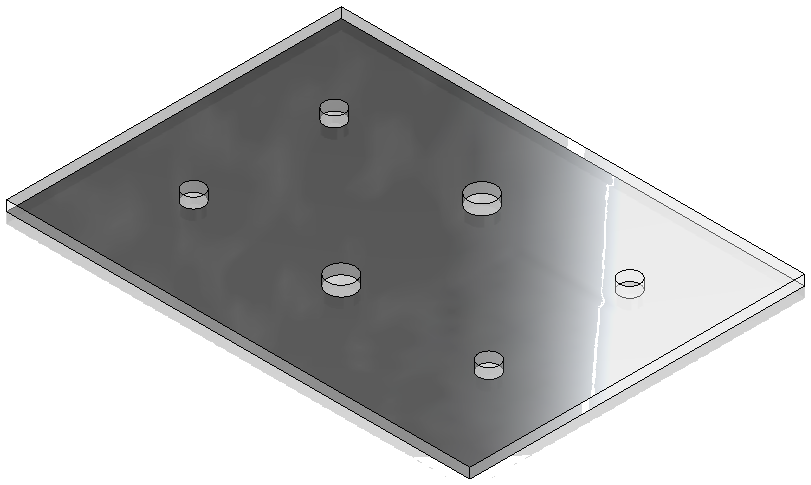 |
| Glass cover side | `Glass cover side.SLDPRT` | 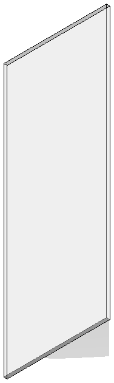 |
| Glass cover back | `Glass cover back.SLDPRT` | 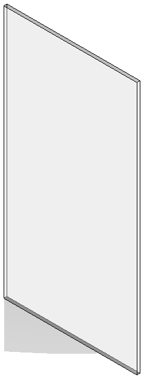 |

## Design

- **Shaft:** a wooden base with guide rods and glass covers on the top, side and back, so the moving parts can be seen.
- **Cabin:** an open box with a door panel that slides up and down along the guide rods.
- **Drive:** a rope runs over a pulley at the top; the pulley turns on a shaft held by a shaft holder.
- **Counterweight:** balances the cabin on the other side of the pulley, so the motor needs less force.

## Files

All SolidWorks files are in [`cad/`](cad). Download the whole folder and open `elevator assembly.SLDASM`; the assembly finds its parts in the same folder.

## Author

**Ahmed Mohamed Elanany** · [LinkedIn](https://www.linkedin.com/in/ahmed-elanany) · ahmedelanany34@gmail.com
